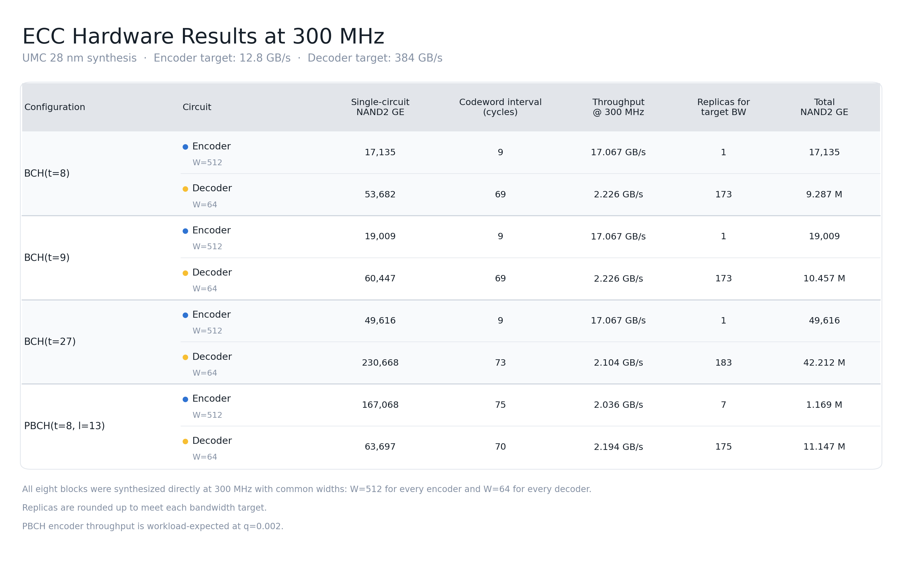

# Outlast BCH/PBCH hardware evaluation

This repository contains the synthesizable ECC hardware used for the Outlast
paper evaluation. The authoritative final release is in
[`paper_eval/`](paper_eval/); the older top-level `bch/`, `pbch/`, and `reports/`
directories are retained only as provenance for earlier design points.

## Final four configurations

All configurations protect a 4,096-bit (512-B) payload over `GF(2^13)`.

| Configuration | Role | Redundancy | Codeword bits |
|---|---|---:|---:|
| BCH(`t=8`) | Conventional baseline | 104 | 4,200 |
| BCH(`t=9`) | Same redundancy as Outlast | 117 | 4,213 |
| BCH(`t=27`) | Minimum BCH meeting the reference UBER target | 351 | 4,447 |
| Outlast (`t=8`, `l=13`) | Main paper configuration | 117 | 4,213 |

Outlast (`t=8`, `l=13`) and BCH(`t=9`) are the equal-redundancy pair. Under
the paper's reference point—`RBER_error=1e-5`, `RBER_defect=1e-3`, ideal
probing, `UBER=FER/n`, and target UBER `1e-16`—BCH requires `t=27`, whereas
Outlast meets the target with `t=8,l=13`. The latter pair is therefore the
minimum-configuration comparison at a common reliability target, not a claim
that their numerical UBER is identical under every channel condition.

## Final hardware point

- UMC 28-nm 0.9-V slow library, direct 300-MHz synthesis
- `W=512` for every encoder and `W=64` for every decoder
- Encoder target: 12.8 GB/s; decoder target: 384 GB/s
- NAND2 GE normalization: 0.504 um2 per NAND2 gate
- Pre-layout mapped-cell results; no advanced-node area extrapolation

| Configuration | Provisioned engines | Total NAND2 GE |
|---|---:|---:|
| BCH(`t=8`) | 1 encoder + 173 decoders | 9.304 M |
| BCH(`t=9`) | 1 encoder + 173 decoders | 10.476 M |
| BCH(`t=27`) | 1 encoder + 183 decoders | 42.262 M |
| Outlast (`t=8`,`l=13`) | 7 encoders + 175 decoders | 12.317 M |

Relative to equal-redundancy BCH(`t=9`), Outlast costs 17.6% more total gates.
Relative to BCH(`t=27`), the minimum BCH configuration meeting the same UBER
target at the reference channel point, Outlast uses 70.9% fewer total gates.

## Reproduce and inspect

- [Release overview](paper_eval/README.md)
- [Evaluation rationale and interpretation](paper_eval/docs/HARDWARE_EVALUATION.md)
- [Machine-readable results](paper_eval/results/paper_hardware/blocks_300mhz_common_width.csv)
- [Timing summary](paper_eval/results/paper_hardware/timing_summary.csv)
- [PNG table](paper_eval/results/paper_hardware/ecc_hardware_table_300mhz_common_width.png)
- [SVG table](paper_eval/results/paper_hardware/ecc_hardware_table_300mhz_common_width.svg)

The repository excludes proprietary cell libraries, mapped netlists, DDC
databases, and raw EDA logs. It includes the selected RTL, generated wrappers,
self-checking testbenches and vectors, synthesis scripts, and summarized
results needed to audit the reported point.
