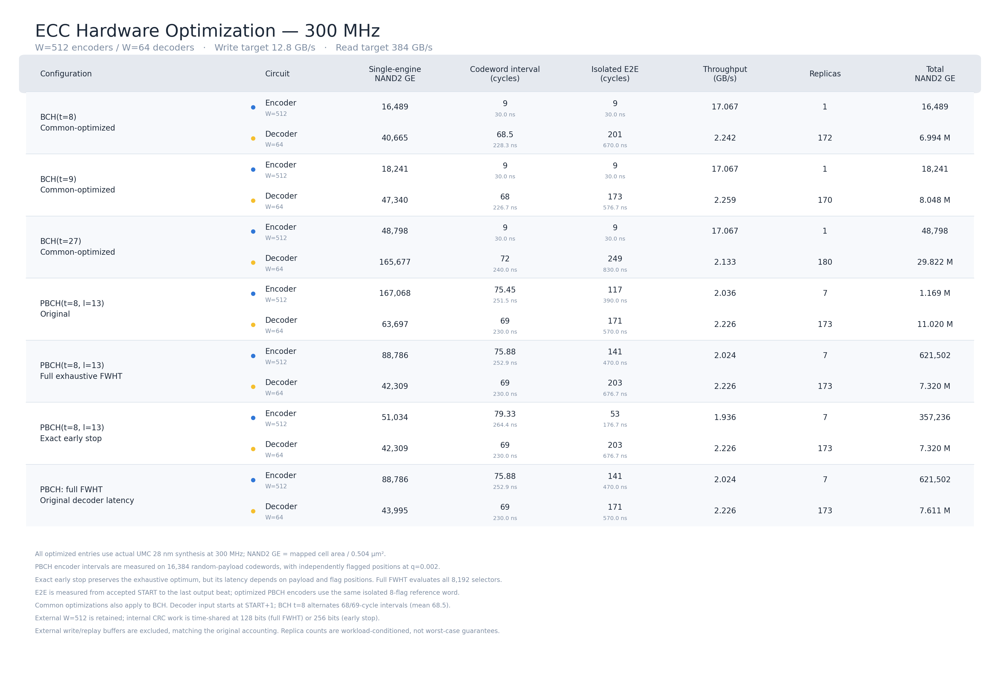

# Outlast BCH/PBCH hardware evaluation

This repository contains the synthesizable ECC hardware used for the Outlast
paper evaluation. The latest optimized hardware release is in
[`paper_eval/optim/`](paper_eval/optim/); the original four-configuration release
remains in [`paper_eval/`](paper_eval/). The older top-level `bch/`, `pbch/`, and `reports/`
directories are retained only as provenance for earlier design points.

## Final four configurations

All configurations protect a 4,096-bit (512-B) payload over `GF(2^13)`.

| Configuration | Role | Redundancy | Codeword bits |
|---|---|---:|---:|
| BCH(`t=8`) | Conventional baseline | 104 | 4,200 |
| BCH(`t=9`) | Same redundancy as Outlast | 117 | 4,213 |
| BCH(`t=27`) | Minimum BCH meeting the reference UBER target | 351 | 4,447 |
| Outlast (`t=8`, `l=13`) | Main paper configuration | 117 | 4,213 |

Outlast (`t=8`, `l=13`) and BCH(`t=9`) are the equal-redundancy pair. Under
the paper's reference point—`RBER_error=1e-5`, `RBER_defect=1e-3`, ideal
probing, `UBER=FER/n`, and target UBER `1e-16`—BCH requires `t=27`, whereas
Outlast meets the target with `t=8,l=13`. The latter pair is therefore the
minimum-configuration comparison at a common reliability target, not a claim
that their numerical UBER is identical under every channel condition.

## Latest hardware optimization — November 14, 2026

- UMC 28-nm 0.9-V slow library, direct 300-MHz synthesis
- External `W=512` for every encoder and `W=64` for every decoder
- Encoder target: 12.8 GB/s; decoder target: 384 GB/s
- NAND2 GE normalization: 0.504 um2 per NAND2 gate
- Pre-layout mapped-cell results; no advanced-node area extrapolation

| Configuration | Provisioned engines | Total NAND2 GE |
|---|---:|---:|
| BCH(`t=8`), common-optimized | 1 encoder + 172 decoders | 7.011 M |
| BCH(`t=9`), common-optimized | 1 encoder + 170 decoders | 8.066 M |
| BCH(`t=27`), common-optimized | 1 encoder + 180 decoders | 29.871 M |
| Outlast (`t=8`,`l=13`), full exhaustive FWHT | 7 encoders + 173 decoders | **7.941 M** |

The selected Outlast encoder evaluates all 8,192 selectors and preserves the
frozen code and tie break. Applicable optimizations are also applied to BCH.
Under this synthesis/workload setup, total Outlast gates are **1.55% below
equal-redundancy BCH(t=9)**—near-parity, not a technology-independent advantage.
Compared with the original PBCH remeasured under the same input timing,
single-engine encoder/decoder gates fall by 46.86%/33.58%, and total gates
fall by 34.85%. The encoder remains larger than BCH's; the smaller, heavily
replicated decoder offsets that cost.

The minimum-gate point trades latency for sharing: at eight flags the encoder
takes 141 cycles (470 ns), and the decoder takes 203 cycles (676.7 ns).
Keeping original decoder latency gives 8.233 MGE (+2.07% versus BCHt9).
A conservative encoder retaining all seven inner butterfly stages gives
8.075 MGE (+0.12% versus BCHt9). An exact-early-stop experiment is documented
separately and is not the always-full-search recommendation.

PBCH encoder provisioning uses 16,384 random-payload codewords with independent
flag probability q=0.002; it is not a worst-case service guarantee. External
replay/write buffers are excluded. The 32-flag cap is unchanged: analytic UBER
claims require a separate justified hardware overflow policy. Reported timing
is pre-layout setup timing, not CTS/hold-repaired physical signoff.

## Reproduce and inspect

- [Optimization results, design changes, and verification](paper_eval/optim/README.md)
- [Portable reproduction instructions](paper_eval/optim/REPRODUCE.md)
- [Optimized machine-readable results](paper_eval/optim/results/hardware_comparison.csv)
- [Conservative/full-FWHT alternatives](paper_eval/optim/results/full_fwht_alternatives.csv)
- [Original release overview](paper_eval/README.md)
- [Evaluation rationale and interpretation](paper_eval/docs/HARDWARE_EVALUATION.md)
- [Machine-readable results](paper_eval/results/paper_hardware/blocks_300mhz_common_width.csv)
- [Timing summary](paper_eval/results/paper_hardware/timing_summary.csv)
- [PNG table](paper_eval/results/paper_hardware/ecc_hardware_table_300mhz_common_width.png)
- [SVG table](paper_eval/results/paper_hardware/ecc_hardware_table_300mhz_common_width.svg)

The repository excludes proprietary cell libraries, mapped netlists, DDC
databases, compiler logs, and executable build products. It includes selected
source snapshots, RTL/generators, self-checking testbenches, functional test
logs, synthesis area/timing reports, and summarized results. Large workload
vectors are regenerated from recorded seeds. Failed explorations are marked
and excluded from final results; 62 completed synthesis runs do not mean
62 functionally verified designs.
